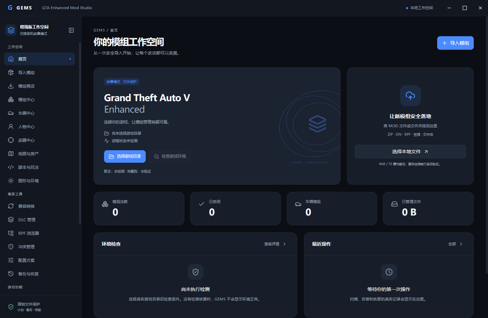

# 0.1.77-oss.1 verification / 本次验证

Verification date: **2026-10-26, Asia/Hong_Kong**. This is the first proposed public source preview, prepared from the existing local 0.1.76 code. No older public release, maintainer tenure, usage figure or community adoption is inferred from the version number. Historical notes remain historical.

## Environment and executed checks

Windows x64; Node.js 24.19.0; npm 11.17.0; Git 2.55.0.windows.5. Electron 44.7.0 was extracted from an existing official distribution archive whose SHA-256 matched the installed npm package's checksum (`eee30dc8fa1f5ea95490e59f44e46ea68dd24c6e93d22facf70fe5c2d4c2665c`). No application-control or security setting was changed.

| Check | Actual result | Scope |
| --- | --- | --- |
| Clean `npm ci --ignore-scripts --no-audit --no-fund` | Passed, 350 packages | First restricted-network attempt failed DNS resolution; normal network access succeeded. No original node_modules reused. Electron installed separately as described above. |
| `npm run build` | Passed | TypeScript check, Vite renderer and bundled Electron main/preload. Framer Motion `use client` bundler warnings remain non-fatal. |
| `npm test` | **795 passed; 0 failed; 0 skipped** | Real temporary filesystem/SQLite fixtures, unsafe archives, conflicts, backups, external changes, checkpoint interruption, RPF payloads and source packaging. |
| Source publication regressions | Passed, 53 targeted checks and 2 final archive-policy checks | No reliance on an unpublished game-assistant DLL; temporary synthetic PE headers used for failure/manifest tests. Exact reviewed screenshot exception checked separately. |
| `npm run test:ui` | Passed | Actual Electron desktop, 22 views, theme/scale, IPC import/install/restore, overwrite cancellation, ownership protection, RPF browsing/extraction, restart recovery and synthetic 120-record garage/search fixture. |
| Production npm advisory check | **0 known advisories after patch** | Initial check found vulnerable transitive undici 7.30.0; lockfile updated to 7.30.1. This is a dated registry result, not a guarantee of security. |
| Source ZIP CRC/SHA | Passed; see final source verification JSON shipped alongside ZIP | Every archived file matched the curated tree; private logs, SDK binaries and game/MOD files excluded. |
| Clean extracted source | Passed: fresh offline `npm ci --ignore-scripts` (350 packages), then `npm run build` | A separate empty directory was populated only from the source ZIP; npm packages came from the verified registry-download cache. No original source files or node_modules linked. A sandbox cache-access denial was resolved by using normal file permissions. |

The first UI attempt inside the restricted command sandbox failed to launch. The normal desktop test subsequently completed successfully. This does not establish why old binaries were blocked, and does not override the historical Windows policy reports. Tests use temporary directories and synthetic game structures; no real game folder was installed into or restored.

The screenshot is from the actual current desktop regression with no game bound and no real mods. The 120-record stress fixture is synthetic test data, not usage or adoption evidence.

## Confirmed scope and remaining limits

See the [feature matrix](FEATURE_STATUS.md). Bounded import, plain-file installation, backup/restore, uninstall protection and diagnostics are verified within the tested fixture scope. Resource classification is partial. The RPF library rebuilds separate binary archive copies; the desktop does not write those copies into the game.

- Legacy-to-Enhanced conversion remains disabled; DLC registration, encrypted RPF editing and model rendering are unavailable.
- This work does not verify Enhanced story-mode loading, gameplay, mod compatibility, the native game assistant or commercial/paid MOD resources.
- Cross-process ownership/locking, arbitrary concurrent writers, hardware power loss and real large-mod workloads are outside the recorded results.
- No signed installer, portable EXE or native assistant binary is part of this preview. A workflow file does not prove a GitHub Actions run has occurred.
- No verified stars, downloads, user feedback or public release history is currently available.

## 本次结果说明

本轮沿用已有源码，建立独立公开副本，修复源码打包范围与未公开 DLL 的测试依赖，并更新已知有漏洞的间接依赖。795 项核心测试及真实 Electron 桌面回归通过，测试目录与用户游戏目录隔离。源码公开、申请提交、官方获批与福利激活是独立状态；本文件不表示任何申请已提交或获批。

未实现功能不因页面入口存在而视为可用。旧版文档的测试数量、游戏路径和发行说明仅供追溯；本次记录和最终附件校验文件是当前预览的证据。

Upstream security evidence: [undici advisory](https://github.com/nodejs/undici/security/advisories/GHSA-xjj6-f33q-929c), [7.30.1 release](https://github.com/nodejs/undici/releases/tag/v7.30.1).
